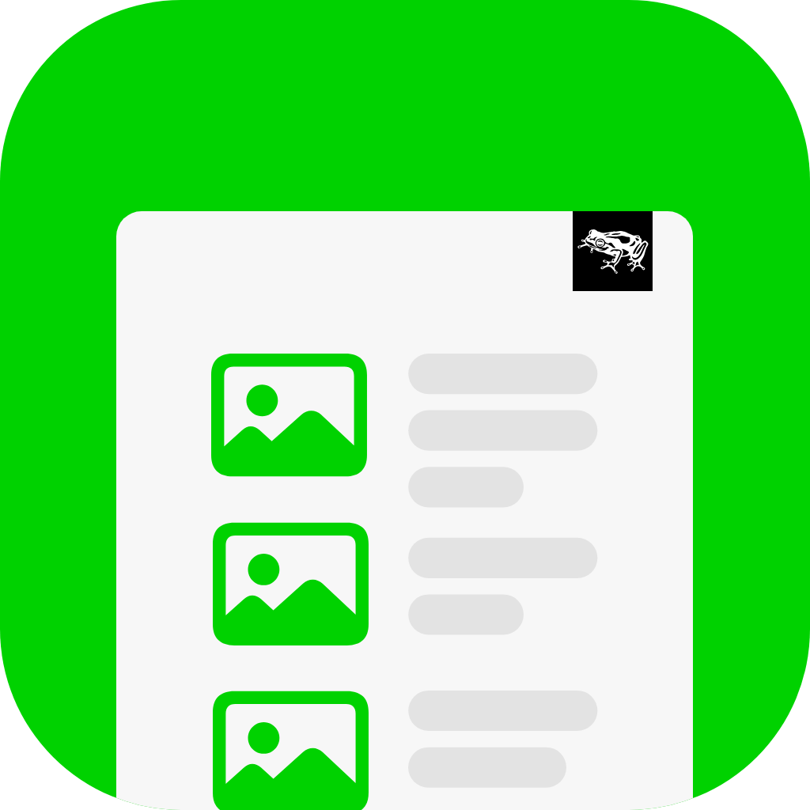

  

# Caddy

Turn a finished ad into an editable CAD script, without screenshotting every frame by hand.

Before an ad goes to air, the brand and creative team has to produce a CAD script: the audio and vision script, voiceovers, jingles, graphics, supers and disclaimers. Done by hand, that means grabbing a copy of the finished asset, screenshotting every frame change, noting down everything on screen and in the audio, and assembling it all in a Word document. For a one-minute ad, that's around 20 minutes, every time.

Caddy is a native Mac app that does the legwork. Drop in a finished video and it proposes the sections, reads the on-screen text, transcribes the voiceover and fills in a script for you to check and edit. Then you export a Word or PDF document that's ready to send.

## What it does

- **Finds the sections for you.** Caddy detects scene changes and proposes a section for each one. Split a section where you want one, or join it back into the one before.
- **Suggests the content.** On-screen text becomes suggested Supers (fine print such as offer terms goes to Disclaimers), and the voiceover is transcribed and placed in the section it belongs to.
- **Keeps you in charge.** Suggestions are tinted purple and are only drafts. Confirm them one at a time or all at once, edit them, or dismiss them. Dismissed suggestions don't come back.
- **Edits like a script.** Each section holds elements in the order they happen: scene description, voiceover, super (on-screen text), sound effect, music and disclaimer. Drag them to reorder, move them between sections, duplicate them, or change their type. Text supports bold, italic and underline.
- **Two views.** Playback shows the video with the current section beside it. The grid shows every section as a row, with frames you can skim by hovering.
- **Adjustable detection.** The sparkles button in the toolbar sets how sensitive scene and text detection are. Sections you've already edited are never replaced.
- **Exports to Word or PDF.** Choose a client name, asset name and what to include (frames, scene descriptions, suggestions). The export uses the team's CAD script layout.
- **Keeps a library.** Scripts save as you work and live in one window, grouped into folders. Rename, move and delete from the sidebar, or drag a script onto a folder.

## Privacy

Everything happens on your Mac. Scene detection, text recognition and transcription all run locally, and your videos, frames and transcripts are never sent anywhere.

The one exception is **Help › Report an issue…**, which sends only what you type in the form, plus the app version, build, macOS version and Mac model. It never includes scripts or videos.

## Requirements

- macOS 26.2 or later
- A finished video as an MP4, MOV or M4V file. MKV and AVI aren't supported.

## Install

Download the latest `Caddy.zip`, double-click it to unzip, then drag Caddy into your Applications folder. It's checked by Apple and needs nothing else installed.

The first time you open it, a short tour walks through the app. You can replay it any time from **Help › Show onboarding**.

## Using Caddy

1. **Add a video.** Choose **File › New Script from Video…** (⌘N) or drop a video into the window. Drop it on a folder to add it there.
2. **Wait a moment.** Sections appear as Caddy works through the video, followed by suggestions for Supers and Voiceover.
3. **Review.** Step through each section, confirm or dismiss the suggestions, and add your own scene descriptions, voiceover, jingles and notes.
4. **Export.** Choose **File › Export…** (⇧⌘E), fill in the client and asset name, pick Word or PDF and save.

### Shortcuts

| Key | Action |
|---|---|
| Space | Play or pause |
| L | Loop the current section |
| ↑ / ↓ | Previous or next section |
| ⏎ | Confirm all suggestions in the section |
| ⌫ | Join with the previous section |
| ⌘F | Split a section at the current point in the video |
| ⌘B / ⌘I / ⌘U | Bold, italic, underline |
| ⌘N / ⇧⌘N | New script from video, new folder |
| ⇧⌘E | Export |

### If the video moves

Caddy follows a video through renames and moves on the same disk. If it can't find it, the player shows **Video not found**. Choose **Locate Video…** and every section and edit stays as it was. Caddy warns you if the new file's length differs from the one it analysed.

## Limitations

- Suggestions are drafts. Read the whole script before it goes anywhere.
- Text recognition can struggle with stylised or animated type, and it reads text in the scene (signage, for example) as well as supers. Dismiss anything that isn't a super.
- You can't yet add an existing script alongside the video.
- Substantiation documents aren't part of the export.

## Feedback

Something not working, or an idea? Choose **Help › Report an issue…** in the app. You don't need an account.

Developers: see [docs/DEVELOPING.md](docs/DEVELOPING.md).
